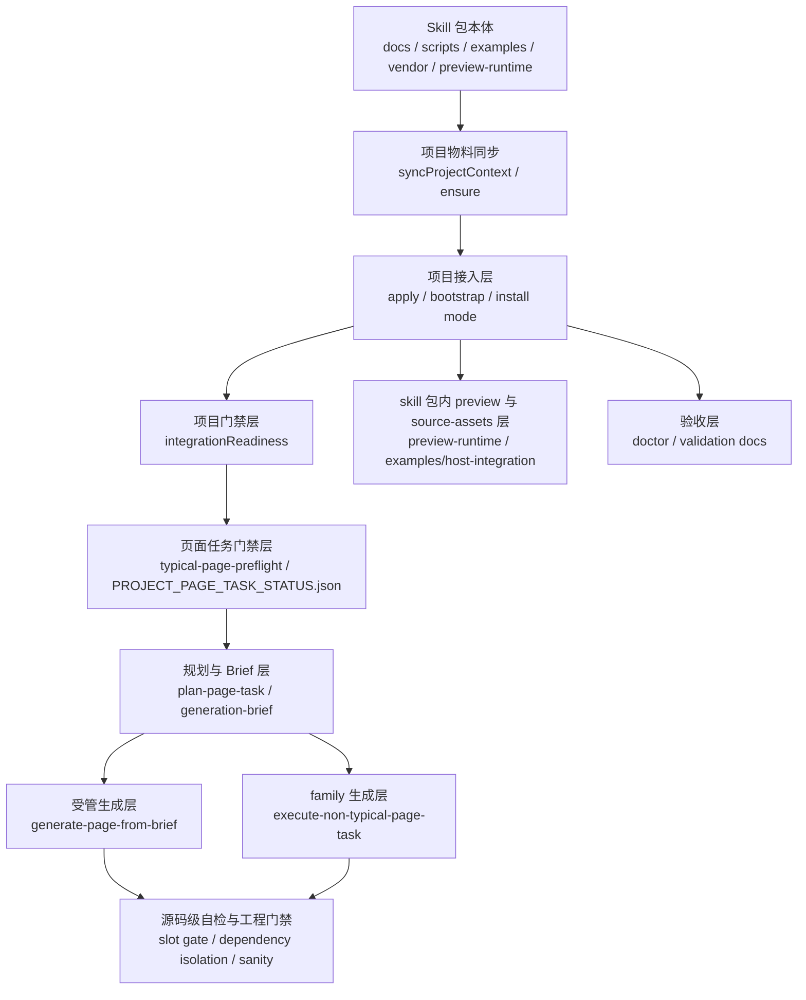

# hiui-design 架构与运行逻辑说明

## 1. 文档目的

这份文档面向两类读者：

- 想快速理解 `hiui-design` 整体架构、边界和职责分层的使用者
- 需要维护脚本、接入链路、生成器和规则文档的维护者

它不是替代 `SKILL.md`、`docs/README.md`、`docs/onboarding/*`、`docs/generation/*` 的新权威入口，而是把这些分散事实源和脚本真实行为收敛成一份“全局架构图 + 运行主链路解释”。

发生冲突时，建议按以下优先级理解：

1. 脚本真实行为
2. `SKILL.md`
3. `docs/` 下的专题文档
4. 历史输出、旧报告和项目内运行快照

## 2. 一句话理解 hiui-design

`hiui-design` 不是单一“页面生成脚本”，而是一个把 **项目接入、页面规划、模板生成、宿主挂靠、预览联调、工程门禁、验收校验** 合在一起的单 skill 可移植能力包。

它的核心目标不是“让 AI 自由写一个像后台的页面”，而是：

- 先把项目拉到受管、可证明的接入状态
- 再把页面任务放行到可生成状态
- 再基于官方母版、manifest、slot boundary 和宿主合同生成页面
- 全程 fail closed，尽量避免“先写一版，再靠补丁和猜测修回来”

## 3. 架构总图



## 4. 设计原则

从文档和脚本可以看出，`hiui-design` 的底层设计原则非常稳定，主要有下面几条。

### 4.1 单 skill 完整交付

这个目录本身就是完整能力包，不再拆成“接入 skill”“生成 skill”“验收 skill”三份分散物料。`skill.manifest.json` 里把以下目录统一定义为安装合同的一部分：

- `docs`
- `scripts`
- `examples`
- `preview-runtime`
- `vendor`
- `templates`
- `manifests`
- `rules`

这意味着它既是：

- 文档事实源
- 安装分发包
- 本地脚本工具箱
- 官方母版与示例库
- preview runtime 承载层
- 生成/校验规则库

### 4.2 项目级与页面级严格分层

`hiui-design v2` 把逻辑拆成两层：

- 项目级：回答“这个项目如何接入 hiui-design”
- 页面级：回答“这个页面属于什么家族/页型，应该走哪条生成路径”

项目级只关心接入模式、宿主画像、物料同步、运行时基线和门禁状态。

页面级才关心：

- 输入方式
- 页型/页面家族
- 生成路径
- 导航挂靠
- 母版与槽位替换

这套分层是整个工程最重要的稳定器之一，因为它避免了“项目还没 ready，就先去分析旧页面、猜路由、写新页面”的失控行为。

### 4.3 先 gate，再生成

几乎所有关键入口都遵守同一个规则：

- 项目物料未同步，只能 `ensure-or-stop`
- 页面任务门禁未打开，只能 `preflight-or-stop`
- 导航挂靠点不明确，只能 `ask-user` 或 fail closed
- 页型没有 manifest 契约，只能补契约，不能脑补母版

这也是为什么 `generation-brief.mjs` 和 `generate-page-from-brief.mjs` 都会在真正写页面前重复检查 gate，而不是相信上游调用者。

### 4.4 官方母版优先，不鼓励自由手写

标准典型页的默认策略不是“AI 参照文档手写页面”，而是：

1. 命中页型
2. 读取 `page-types.manifest.json`
3. 读取 `page-slot-boundaries.md`
4. 选择最近官方母版
5. 只替换业务槽位

对于 `non-typical-page` family，也不是让 AI 直接自由写 page frame，而是先形成 `nonTypicalDecisionPackage`，再进入 family-specific generator。

### 4.5 preview 与正式业务隔离

从 `SKILL.md`、`integration-modes.md`、`preview-runtime.mjs` 到 `scripts/README.md`，都在强调一件事：

- preview 资产是参考、联调、smoke、doctor 的基线
- preview 资产不再物化进业务项目
- preview route tree 不允许进入正式菜单树
- 真实业务页必须落到目标项目自己的业务目录和正式导航上

这里还要再补一层容易混淆的边界：

- `.local-context/hiui-design/examples/host-integration/**` 仍然可能出现在目标项目里，因为它承担官方母版、shim、formal shell source、bridge 物料等 source-asset 职责
- 但这些 source assets 不再等价于“项目内可预览的典型页应用”；目标项目不应再挂载它的 preview routes、preview host、preview app 或 gallery

这一点是整个 v2 架构里非常关键的边界。

## 5. 目录与模块职责

下面这张表可以把 `hiui-design` 的目录结构和职责快速对齐。

| 路径 | 核心职责 | 典型内容 |
| --- | --- | --- |
| `SKILL.md` | 主 skill 合同、P0 gate、默认工作流、硬规则 | 接入前置、页型生成规则、常用命令 |
| `docs/` | 文档事实源 | onboarding、generation、validation、architecture |
| `scripts/` | CLI 入口层 | apply、ensure、preflight、brief、generate、doctor |
| `scripts/lib/` | 核心运行逻辑层 | readiness、mode resolution、navigation、generator、sanity |
| `examples/host-integration/` | 官方母版与宿主 source facts | 典型页模板、app-frame-core、host-reset、layout bridge |
| `preview-runtime/` | skill 包内 preview runtime | 官方示例运行环境 |
| `vendor/` | 可选嵌入来源快照 | 来源包的 `tgz`（压缩包）与 package 快照；目标项目实际补依赖仍以 `docs/onboarding/managed-local-runtime-dependencies.json` 为准 |
| `templates/` | 补充模板资产 | i18n 初始化模板 |
| `manifests/` | 可扩展事实源容器 | 页面/能力覆盖层 |
| `config/` | 配置与默认环境 | stats env 等 |

## 6. 关键概念与状态机

理解 `hiui-design`，最重要的是先理解几组状态名。它们不是同义词，职责分得很细。

### 6.1 `integrationReadiness`

它只回答一件事：

“项目本地的 hiui-design 接入物料是否已经同步并具备基本 apply-state。”

由 `scripts/lib/integration-readiness.mjs` 负责检查，核心判断包括：

- `.local-context/hiui-design/` 是否存在
- 是否具备最小 marker：
  - `.context.jsonc`
  - `scripts/apply-in-current-project.mjs`
- `outputs/HIUI_DESIGN_APPLY_STATE.json` 是否存在
- `appliedMode` 是否是合法的非 `auto` 模式
- 宿主轻量兼容性是否已能读取

常见状态：

- `missing-context`
- `missing-apply-state`
- `invalid-apply-state`
- `invalid-applied-mode`
- `ready`

注意：`integrationReadiness.ready=true` 只代表“项目物料已同步”，不代表“已经可以开始写页面”。

### 6.2 `pageTaskReadiness`

它是页面任务门禁，状态写在：

- `.local-context/hiui-design/outputs/PROJECT_PAGE_TASK_STATUS.json`

核心状态只有两个：

- `ensure-only`
- `ready-to-generate`

含义非常明确：

- `ensure-only`：项目只完成了物料同步，页面任务还不能开始
- `ready-to-generate`：项目门禁通过，可以进入页面规划和写入链路

这个状态由 `typical-page-preflight.mjs` 打开，而不是由 `apply` 或 `ensure` 打开。

### 6.3 freshness

即使上一次 preflight 已通过，`pageTaskReadiness` 也不是永久有效。

`scripts/lib/page-task-gate.mjs` 会对以下输入做哈希快照：

- `package.json`
- lockfile
- app entry
- build config
- `.local-context/hiui-design/.context.jsonc`
- formal host contract

只要这些关键输入发生漂移，门禁就会重新收敛成 `ensure-only`，要求再次运行 `typical-page:preflight`。

这说明 `hiui-design` 把“项目可生成状态”建模成一个会失效的快照，而不是一次性打钩。

### 6.4 `generationReadiness`

它是 preflight 之后更细的项目生成能力评估，来自 `generation-readiness.mjs`。它主要关心：

- 宿主高度链是否连续
- 公共外壳 baseline 是否成立
- 新项目首个受管 formal shell 是否需要建立，以及是否满足官方一致性要求
- 老项目真实页面挂靠点是否已确认
- 已存在 formal shell 是否只作为迁移/治理诊断，而不是老项目页面生成硬前置
- 导航注册表是否可证明
- 是否需要首次建立 formal shell

它比 `integrationReadiness` 更接近“真实写页前工程条件是否成熟”。

### 6.5 `AI_GENERATION_READY_CONTEXT.json`

这是 preflight 刷新的机器可读上下文入口之一，里面会给出：

- `allowedPageTypes`
- `conditionalPageTypes`
- `blockedPageTypes`
- `pageTypes[].generationContract`
- `pageTypes[].requiredDocs`
- `pageTypeManifestSnapshot`
- `projectHostContext`
- `managedLocalRuntime`
- `managedLocalRuntimeMaterialized`
- `managedLocalRuntimeBlockedBy`
- `publicShell`
- `formalShell`
- `formalHostCompatibility`
- `navigationSupport`
- `readyToGenerate`
- `readyToExecute`

从架构上看，它现在不只是“页型能力列表”，还承担“单一机器快照”的职责：把“当前项目状态 + 页面生成能力 + 页型执行合同摘要 + 入口挂靠摘要”统一投影成一个 AI 可消费的最小上下文包。下游 `generation-brief` 会优先消费这份快照里的页型执行合同；只有当快照缺字段或产物过旧时，才回退读取 `page-types.manifest.json`。

其中本地运行时相关字段要这样理解：

- `managedLocalRuntime`：完整状态块，来自 `PROJECT_HOST_CONTRACT.json.managedLocalRuntime`
- `managedLocalRuntimeMaterialized`：布尔派生字段，只回答“本地运行时是否已经物化”
- `managedLocalRuntimeBlockedBy`：阻断原因列表，只回答“为什么本地运行时还没有达到可物化/可引用状态”

这三者的作用，是把“页面壳基座是否已物化”显式暴露给 AI 和维护者；它们不替代页面任务门禁。即使 `managedLocalRuntimeMaterialized=true`，如果 `pageTaskReadiness` 仍未放行为 `ready-to-generate`，页面生成也必须继续停止。

### 6.6 `PROJECT_HOST_CONTRACT.json.executionContract`

随着执行层 `host adapter`（宿主适配器，指把不同挂靠执行方式拆成独立小模块）逐步拆分，项目级 contract 里还需要显式写出 `executionContract`：

- 它描述项目已经证明的执行机制摘要
- 它不替代页面级 `navigationMountAction`
- 它不新增第二份导航事实源

简单说：

- `formalNavigation` 负责回答“项目级导航事实是什么”
- `projectEntryMountCapability` 负责回答“真实入口能不能承接受管首壳”
- `executionContract` 负责回答“当前项目已经证明了哪类执行机制，关键入口在哪里”

## 7. 架构分层详解

### 7.1 分发与项目物料同步层

这一层解决的问题是：

“如何把 skill 包能力 materialize 到目标项目里。”

关键文件和逻辑：

- `skill.manifest.json`
- `distribution-manifest.json`
- `scripts/lib/project-context-sync.mjs`
- `docs/architecture/project-context-materialization.md`

运行逻辑：

1. `skill.manifest.json` 声明 required paths
2. `syncProjectContext()` 读取 manifest，展开所有 required paths
3. 把这些文件复制到目标项目 `.local-context/hiui-design/`
4. 通过 `.hiui-design-context-sync-manifest.json` 记录上次同步的 source hash
5. 后续同步时根据 hash 判断：
   - `created`
   - `refreshed`
   - `overwritten`
   - `up-to-date`
   - `conflict`
   - `untracked-existing`

这层很重要，因为 `hiui-design` 并不依赖外部 registry 成功才算 materialized。文档已经明确指出：`lcm init / registry add / link` 不能等价为“项目内已有完整 `.local-context/hiui-design/`”。

### 7.2 模式决策与接入层

这一层负责回答：

“当前项目该走哪种接入方式，以及 apply 时要补哪些基线。”

关键文件：

- `scripts/apply-in-current-project.mjs`
- `scripts/bootstrap-target-project.mjs`
- `scripts/setup-for-designers.mjs`
- `scripts/lib/install-mode-resolution.mjs`
- `scripts/lib/install-mode-capability.mjs`
- `docs/onboarding/integration-modes.md`
- `docs/onboarding/host-profiles.md`

模式只有两个对外主模式：

- `rules-only`
- `host-integration`

已下线历史模式已从当前对外模式集合移除；如需查看旧链路，只能通过 git 历史恢复对应版本。

#### `host-integration`

适合：

- React/Vite 原生兼容载体
- 新项目/轻骨架
- 需要 preview、smoke、doctor 基线
- 能接通 portal、高度链、样式资源和依赖线

特点：

- 优先接入更完整的宿主基线和 guidance
- 官方示例由 skill 包内 `preview-runtime/` 承载
- 正式业务页仍写入目标项目业务目录
- 必要时允许在 `greenfield + host-integration + 尚无业务导航` 的前提下，自动补首个 formal shell

#### `rules-only`

适合：

- 老项目有自己的布局、路由、目录体系
- 或宿主需要项目本地兼容桥
- 或明确不需要 preview/smoke/doctor 基线

特点：

- 仍然要补运行时 baseline
- 仍然从官方母版生成页面
- 只是不会把 skill 包内 preview runtime 对应的入口逻辑接到项目里
- 真实业务页继续落到目标项目既有结构中

#### 自动模式如何决策

`resolveAutoInstallMode()` 的逻辑很干净：

1. 先复用 `apply-state` 记录的 mode
2. 如果没有，则调用 `evaluateInstallModeCapability()`
3. 根据 host profile 是否需要“项目本地兼容桥”来决定：
   - 不需要：`host-integration`
   - 需要：`rules-only`

目前原生兼容框架主要是：

- `react-vite`
- `react-vite-router`
- `react-vite-custom-layout`
- `react-router-custom`

需要桥接、默认降级到 `rules-only` 的包括：

- Umi
- Next
- 微前端容器等

### 7.3 项目门禁层

这一层的两个核心脚本是：

- `ensure-in-current-project.mjs`
- `typical-page-preflight.mjs`

#### `ensure-in-current-project.mjs`

职责很克制，只做“轻量补齐”，不做页面放行。

执行顺序：

1. 检查 `integrationReadiness`
2. 如果已 ready：
   - 可选 `--force-context-sync`
   - 刷新本地 context
   - 重跑 apply
   - 然后把页面任务状态写成 `ensure-only`
3. 如果是 `missing-context`：
   - 先同步 `.local-context/hiui-design/`
4. 如果是 apply-state 缺失或非法：
   - 调用 `apply-in-current-project`
5. 最终总会把 `PROJECT_PAGE_TASK_STATUS.json` 重置/写成 `ensure-only`

也就是说，`ensure` 的角色不是打开门，而是把项目收敛到“可以再去 preflight 一次”的状态。

#### `typical-page-preflight.mjs`

这是正式页面任务的放行脚本。

执行顺序：

1. 检查 `integrationReadiness`
2. 未 ready 时：
   - 返回 `status=blocked`
   - 给出 `nextCommand`
3. ready 时：
   - 调用 `syncPageTaskStatusFromPreflight()`
   - 生成/刷新：
     - `PAGE_TYPE_CAPABILITY_REPORT.json`
     - `AI_GENERATION_READY_CONTEXT.json`
     - `PROJECT_HOST_CONTRACT.json`
     - `PROJECT_STATE_SUMMARY.json` 相关产物
4. 如果 `generationReadiness.status === ready`
   - 把 `pageTaskReadiness` 写成 `ready-to-generate`
5. 否则继续保持 `ensure-only`

所以从运行逻辑上，真正能让页面开始生成的不是 `apply`，而是 `preflight`。

这里新增一个必须遵守的事实源边界：

- `PROJECT_HOST_CONTRACT.json` 是 preflight 阶段唯一受支持的“项目级宿主事实快照”
- 它至少要冻结 `formalNavigation`、`defaultBusinessPageDir`、`publishMechanism`、`hostExecutionAdapter`、`projectEntryMountCapability`
- `navigationDecision`、`navigationMountDecision` 与 `navigationMountAction` 只允许在拿到具体页级输入后，由页面规划层从 `formalNavigation` 继续推导，不再作为项目级重复快照写回 contract
- 页面生成成功后，允许把已经真实物化完成的项目级结果结算回同一份 contract，例如首个正式业务壳、正式 registry、implicit feature base dir、MF publish config；但这一步只能更新 `formalNavigation` / `executionContract` / `hostExecutionAdapter` 一类项目级事实，不能把页级动作对象原样写回
- `generation-brief.mjs` / `load-generation-brief.mjs` 在页面任务门已经放行后，必须优先复用这份 contract；缺失或损坏时直接 fail closed
- 但在当前实现里，contract 缺失、指纹漂移或证据文件漂移，很多时候会先被 `page-task gate` 的 freshness 收口回 `ensure-only`；只有页面任务门仍显示可继续时，brief 层才会继续以 contract 缺失/失效的理由阻断
- 这种 post-write contract settlement 也不替代 `preflight`：它不会重新打开页面任务门；若写入触碰了高风险项目级输入，后续仍然必须重新执行 `typical-page:preflight`
- 页面规划层不再允许偷偷重新跑一次源码级导航探测来“碰运气补齐事实”

### 7.4 页面规划与 Brief 层

这一层的关键入口是：

- `plan-page-task.mjs`
- `generation-brief.mjs`
- `scripts/lib/load-generation-brief.mjs`

它们负责把项目状态、页型契约、导航挂靠决策和生成边界汇总成单页执行输入。

#### 规划层输入

可能包含：

- `pageType`
- `pageFamily`
- `inputMode`
- `dest`
- `title`
- `routePath`
- `pageAdjustmentContract`
- `navigationMountContract`
- `confirmedGenerationInputJson`
- `nonTypicalConversationOutputJson`

#### 规划层会做什么

1. 读取 `integrationReadiness`
2. 读取 `inspectPageTaskGate()`
3. 读取 manifest、page family contract、host profile
4. 分析目标页型是否允许生成
5. 评估导航挂靠路径
6. 形成 `executionPolicy`
7. 形成 `pageGenerationDecision`
8. 生成最终 brief 或 blocked brief

从这一版开始，规划层还要遵守一个新的分层规则：

1. 项目级事实只来自 `PROJECT_HOST_CONTRACT.json`
2. 页级显式输入只通过 `navigationMountContract`、`dest`、`routePath`、`title` 等 brief 参数叠加
3. 若页级显式合同与项目级 contract 同时存在，页级合同优先；项目级 contract 负责提供默认业务目录、发布机制和已有挂靠证据
4. 规划层不再重复执行 `detectFormalNavigation()` 去刷新项目级导航事实；真正的源码扫描只保留在 `preflight` 里的 `generationReadiness`

`load-generation-brief.mjs` 里有一个很重要的执行策略：

- `integrationGate = ready-to-generate` 时，允许继续
- 否则统一视为 `ensure-or-stop`

它还会把一些危险 fallback 明确列出来，例如：

- 不允许直接手写旧业务页兼容版本
- 不允许退回 `PageTable` 或空白页 fallback
- 不允许在缺少本地 hiui-design context 时猜路由/MF expose

这一层本质上就是“生成前机器总装配”。

### 7.5 导航挂靠与 formal shell 决策层

对 `rules-only + existing-system + Module Federation direct expose`，这一层新增了显式执行适配器 `mf-direct-expose-legacy`：

- 它把“页面源码目录”和“发布入口目录”拆成两条独立事实
- `pageSource.defaultBusinessPageDir` 只回答源码应写到哪个已证明的业务根目录，例如 `src/views`
- `publishEntry.configPath` 只回答 `ModuleFederationPlugin.exposes` 真正在哪个配置文件里维护
- `publishEntry.managedPublishEntryPath` 只回答需要物化的受管 `mf-entry.*` 在哪里
- 后续生成器只消费这份适配器结果，不再在写页阶段重新猜一次源码目录或 expose 配置位置

这是 `hiui-design` 很有特色的一层，也是很多页面生成系统不会做、但它专门做得很重的一层。

关键文件：

- `scripts/lib/generation-readiness.mjs`

核心职责：

- 探测 formal navigation evidence
- 评估 formal shell 的受管一致性与迁移诊断
- 识别隐式 feature registry
- 决定新页面应该挂到哪里
- 判断是否可以自动补首个 formal shell

#### 主要探测对象

- `src/business-shell/routes.*`
- `src/business-layout/routes.*`
- `src/routes.*`
- `src/router/**`
- `src/business-shell/app-frame.*`
- `src/business-layout/app-frame.*`
- `import.meta.glob('/src/features/*/index.*')` 一类隐式入口

#### formal shell 认证重点

不是只看文件名或 marker，而是综合判断：

- 是否有稳定 marker
- 是否导入本地 `app-frame-core`
- `app-frame-core` 是否保留官方宿主结构
- 是否存在 `TypicalPageHostBridge`
- 是否具备连续高度链
- 是否保留 portal bridge 结构

marker 只是辅证，不是认证本身。

这套认证的主要用途是两类：一是新项目首个正式业务导航壳的受管建立，确保补出来的导航和官方典型页面一致；二是对已有 formal shell 做迁移/治理诊断。对旧项目，页面能否继续生成首先看“挂靠点是否已经确认”，不是先看“导航是否已经认证”。

还需要进一步区分两个阶段：

- 项目接入阶段：只识别宿主支持哪类挂载机制，不要求提前回答某一张页面挂到哪里
- 页面生成阶段：在已知 `dest`、标题、路由名、expose 名或显式 `navigationMountContract` 之后，才把挂载机制收口成具体 `navigationMountDecision` / `navigationMountAction`

#### `navigationDecision`

这一步回答的是“策略上该怎么挂靠”：

- `append-to-existing-navigation`
- `reuse-existing-project-navigation`
- `reuse-implicit-feature-navigation`
- `create-formal-host-and-register-first-page`
- 或者 blocked

#### `navigationMountDecision`

这是更轻量的对外摘要，动作只有三类：

- `attach-existing`
- `create-first-formal-shell`
- `ask-user`

#### `navigationMountAction`

这是最终执行动作，必须在写页面前落地：

- `append-existing-registry`
- `materialize-implicit-feature-entry`
- `create-formal-shell-and-mount-entry`
- `ask-user`

这套分层很重要，因为它把“有没有导航证据”“策略上怎么挂”“具体改哪份文件”三个问题拆开了。

### 7.6 受管页面生成层

这一层的核心入口是：

- `generate-page-from-brief.mjs`

它是标准典型页的唯一受支持写页入口。

从代码看，它的行为非常严格。

#### 写页前会做的事

1. 检查目标 `dest` 是否安全
2. 读取 README 里的链接配置
3. 重新加载 generation brief
4. 如果 `integrationGate === ensure-or-stop`
   - 非 dry-run 时可自动补一次 `ensure`
   - 但补完 ensure 后仍要求 `pageTaskReadiness = ready-to-generate`
   - 否则继续阻断
5. 若 brief 被 blocked，则直接抛 `BlockedGenerationError`
6. 按生成器内部工程安全策略复核 dependency isolation
   - 它不负责打开 `PROJECT_PAGE_TASK_STATUS.json`
   - 也不该被理解成项目接入前必须手工先跑的一道独立开门步骤
7. 规划 `pageAdjustmentExecution`
8. 校验 navigation mount action 是否完备
9. 规划要写入的页面/样式/依赖文件

#### 标准典型页生成逻辑

默认路径是：

1. 从官方母版复制最近模板
2. 复制相关样式和 mock 依赖
3. 按 `businessSlotPlan` 替换业务槽位
4. 必要时 patch formal registry 或 app entry
5. 写入目标目录
6. 输出生成报告和主链接

它会 fail closed 的典型情况包括：

- 页面任务 gate 仍未打开
- navigation mount action 不完整
- dependency isolation 失败
- output target 不安全
- page adjustment 执行计划不可落地
- 已有文件存在但未显式 `--force`

换句话说，它不是“尽量写出点东西”，而是“条件不满足就坚决不写”。

### 7.7 non-typical family 生成层

这一层对应：

- `execute-non-typical-page-task.mjs`
- `scripts/lib/non-typical-family-brief.mjs`
- `scripts/lib/non-typical-page-generator.mjs`
- `docs/generation/page-family-workflows.manifest.json`

这说明 `hiui-design` 并不只支持固定典型页，也在逐步支持规则组合型 family。

#### 当前公开支持的 family

目前只公开一个：

- `non-typical-page`

状态是：

- `generator-ready-public-open`

但范围仍然冻结在 validated v1 scope。

#### 支持边界

支持：

- `page-prompt`
- `prototype-screenshot`
- `host-integration`
- `rules-only`
- `new-page-generation`
- archetype:
  - `process-stage-sync`
  - `selection-detail-sync`

不支持：

- `legacy-system-reconstruction`
- 未注册的新 coordination pattern
- 第三方复杂画布/图引擎页面

#### family 生成逻辑

上层推荐通过 `execute-non-typical-page-task.mjs` 走最小闭环：

1. `plan-page-task`
2. `generate-page-from-brief`
3. `non-typical-page-sanity`

而不是自己把 planner、generator、sanity 拼起来。

在数据建模上，`non-typical-family-brief.mjs` 会要求先形成：

- `classification`
- `nonTypicalDecisionPackage`
- `pageHeaderPlan`
- `whiteBodyPlan`
- `regionPlan`
- `coordinationModel`
- `dataShape`
- `designSystemPlan`

随后 generator 再根据 archetype 生成特定内容骨架。

这说明 non-typical 链路虽然比典型页更“AI 驱动”，但依然不是自由生成，而是 contract-driven。

### 7.8 预览、联调与验收层

这一层对应：

- `preview-runtime/`
- `scripts/start-preview-runtime.mjs`
- `scripts/typical-page-doctor.mjs`
- `scripts/typical-page-slot-gate.mjs`
- `scripts/dependency-isolation-check.mjs`
- `docs/validation/checklist.md`

#### preview runtime

作用：

- 让官方示例在 skill 包内运行
- 不再把 preview 物化到业务项目
- 作为 smoke/doctor/对照基线

默认地址相关常量在 `preview-runtime.mjs` 中写死了 host、port 和 example route。

#### doctor

它不是普通生成主路径的默认前置，而是：

- 首次接入验收
- 运行时异常排查
- 正式交付验收
- 宿主壳变更后的重验

它现在只负责刷新项目级验收快照：

- 若 `preflight` 已经把页面任务门禁打开，doctor 只保留 `ready-to-generate`
- 若 `preflight` 还没开门，doctor 只保留 `ensure-only`
- 也就是说，doctor 不再独立把项目从 `ensure-only` 翻到 `ready-to-generate`，也不会反向替代 preflight 关门

#### slot gate

这是源码级轻量结构门禁，检查：

- slot boundary
- region ownership
- layout chain
- 常驻说明 UI 等

#### dependency isolation

主要检查：

- optional embedded tarball
- package 声明
- lockfile
- 已安装版本
- peer 依赖
- 构建层 replacement bridge

它在真正写页前仍可能被 `generate-page-from-brief.mjs` 当作工程安全兜底之一，但它不负责项目 page-task gate，也不要求团队在普通项目里把它单独前置成 `ensure -> dependency-isolation -> preflight` 这样的重流程。

## 8. 不同接入方式详解

### 8.1 `rules-only` 接入链路

可以把它理解为：

“把规则、典型页面壳对应的本地受管运行时、运行时基线和官方母版生成能力带进项目，但不把 skill 包内 preview runtime 对应的入口并入项目。”

典型适用场景：

- 已有大中型后台系统
- 已有 layout/router/features 体系
- 使用 Umi/Next/微前端容器
- 团队只希望在既有业务壳里生成页面

典型运行链路：

1. materialize `.local-context/hiui-design/`
2. `apply-in-current-project --mode rules-only`
3. patch package/runtime baseline
4. 在 app entry 引入本地 host baseline CSS
5. `typical-page:preflight`
6. 读取 capability/context
7. 生成页面到既有业务目录
8. 优先按既有导航/路由体系自动接入；若旧项目挂靠点已确认但当前执行器不支持自动 patch，则输出人工接入说明而不是阻断页面生成

它的重点不是“轻量”，而是“宿主侧克制，不接 preview 资产，并把旧项目的自动挂靠能力与页面源码生成解耦”。

### 8.2 `host-integration` 接入链路

可以把它理解为：

“项目具备更完整的 hiui-design 宿主承载能力，但 preview 仍留在 skill 包内运行。”

典型适用场景：

- React + Vite 新项目
- 轻骨架项目
- 原生兼容载体的旧项目
- 需要 preview/smoke/doctor 的团队

典型运行链路：

1. materialize `.local-context/hiui-design/`
2. `apply-in-current-project --mode host-integration`
3. patch 依赖、运行时、guide、宿主基线
4. 通过 `preview-runtime` 查看官方示例
5. `typical-page:preflight`
6. 若项目尚无业务导航且满足 greenfield 条件，可在首个页面时受管补 formal shell
7. 正式业务页仍接入项目自己的业务目录和正式导航

它的重点不是“preview 代码进项目”，而是“项目可承接完整宿主合同，且可借助 skill 包内 preview 进行联调”。

### 8.3 两种模式的本质区别

| 维度 | `rules-only` | `host-integration` |
| --- | --- | --- |
| preview 承载 | 不进项目，由 skill 包内 preview runtime 参考 | 也不进项目，但项目更适合围绕 skill 包内 preview 基线联调 |
| 宿主接入程度 | 保守，尽量不碰项目正式壳 | 更完整，允许更强的宿主能力接线 |
| 自动模式默认倾向 | 需要项目本地兼容桥时选它 | 原生兼容载体优先选它 |
| 首个 formal shell 自动补齐 | 通常不允许 | `greenfield + host-integration` 条件下允许，而且这是阻止新项目生成裸页面的强门禁 |
| 目标项目画像 | 旧系统、桥接型宿主 | 新项目、轻骨架、原生兼容旧系统 |

## 9. 不同页面生成链路详解

### 9.1 标准典型页链路

这是最核心、最成熟的路径。

适用页型：

- `table-basic`
- `table-stat`
- `tree-table`
- `tree-split`
- `drawer-form`
- `drawer-detail`
- `full-page-edit`
- `full-page-detail`
- `feedback-status`

生成逻辑：

1. 页面任务 gate 必须已打开
2. 先形成 `navigationMountDecision`
3. 再形成并执行 `navigationMountAction`
4. 命中 `pageType`
5. 读取 `page-types.manifest.json` 的 `generationContract`
6. 读取 `page-slot-boundaries.md`
7. 选择最近官方母版
8. 形成 `coverageDecision`
9. 如需局部改造，再形成 `pageAdjustmentContract`
10. 由 `generate-page-from-brief.mjs` 复制母版并替换业务槽位

这条链路强调的是“固定壳层 + 业务槽位替换”。

### 9.2 独立能力页链路

当前最典型的是：

- `data-visualization`

它和普通典型页的区别是：

- 不是简单的字段/列替换
- 会固定页头与 `whiteBody`
- 内容区按独立 workflow 生成
- 可以选择性复用图表级模块
- 不能直接回落到普通表格页的替换式路径

文档里把它描述为“独立工作流生成”。

### 9.3 基础模板上的局部改造链路

这不是新页型，而是生成路径。

适用条件：

- 基础页型明确
- 页面大多数特征仍保留
- 只是模板不完全覆盖本次需求

关键约束：

- 必须形成 `pageAdjustmentContract`
- 不能改写 header owner、main scroll owner、pagination owner 等 locked region
- 没有命中稳定锚点时必须停止，不能退回自由手写

### 9.4 non-typical family 链路

适用：

- 完全不适合现有典型页壳的页面
- 但又仍然服从 HiUI 统一设计系统和 page frame 原则

当前受控路径：

1. 输入理解
2. family classification
3. `nonTypicalDecisionPackage`
4. family workflow manifest 校验
5. archetype-specific generator
6. light sanity

它强调的是“规则组合 + 决策包驱动”，而不是模板复制。

### 9.5 screenshot 输入链路

这不是新的页型，而是新的输入方式。

适用：

- 用户给的是单张原型截图

固定步骤：

1. 抽取共享结构事实
2. 形成 `pageTypeRecommendation`
3. 形成 `promptDraft`
4. 列出 `unknowns`
5. 在对话中确认：
   - `confirmedPageType`
   - `finalPrompt`
6. 之后再进入正常 brief/generate 链路

这说明 screenshot 在 `hiui-design` 里只是“页面理解入口”，而不是 image-to-code 直出器。

## 10. 导航与正式宿主挂靠逻辑

如果只看页面模板，很容易把 `hiui-design` 理解成“复制一个模板页”。但从代码上看，它至少同样重视“页面写进去之后挂到哪里”。

### 10.1 为什么导航挂靠要前置

因为它要避免这些典型错误：

- 页面先写了，但没有正式路由
- 菜单和路由被 patch 到两份不同事实源
- 旧项目自动新建第二套业务壳
- 新项目把 preview app-frame 直接当正式导航
- 隐式 feature registry 项目又被强行补了 formal shell

所以 `navigationMountAction.mustDoBeforePageCode` 只对“当前执行器会自动落地的动作”保持强约束，而不是对所有老项目挂靠场景一刀切。新项目首个正式导航、受管 `businessRoutes` 注册表 patch、以及 `implicit-feature-registry` 物化仍然必须先做再写页面；但 `append-existing-entry` 和 `manual-register-existing-registry` 这类人工确认动作会显式收口成“页面先生成，挂靠后补说明”。

### 10.2 五种挂靠结果

#### `append-existing-registry`

适合：

- 已有当前执行器支持自动 patch 的受管 `businessRoutes` registry

行为：

- 先 patch 现有正式注册表
- 再写页面文件

#### `append-existing-entry`

适合：

- 已通过 `navigationMountContract.entryPath + entryKind` 或唯一 legacy 证据确认旧入口

行为：

- 先生成页面文件
- 再输出人工更新 legacy 入口的接入说明

#### `manual-register-existing-registry`

适合：

- 旧项目已能确认现有 router / registry 挂靠点
- 但这份注册表不是当前执行器支持自动 patch 的受管 `businessRoutes` 形态

行为：

- 先生成页面文件
- 再输出人工把页面注册到现有 router / registry 的接入说明

#### `materialize-implicit-feature-entry`

适合：

- 现有项目通过 `import.meta.glob` 自动发现 feature entry

行为：

- 先在 `implicitFeatureBaseDir` 下物化入口
- 保证可被现有 glob 自动发现
- 再写页面内容

#### `create-formal-shell-and-mount-entry`

适合：

- `greenfield + host-integration`
- 尚无正式业务导航
- app entry 形态可证明支持自动 patch

行为：

- 先物化 `src/business-shell/app-frame.*`
- 再物化 `src/business-shell/routes.*`
- 再 patch app entry
- 最后写页面

### 10.3 什么时候必须阻断

以下情况会 fail closed：

- 业务入口证据有多个但无法唯一选定
- 存在模糊 shell 但没有正式 registry
- 旧项目没有可证明的导航入口
- 显式 contract 指向的 route/menu registry 不一致
- app entry 已经有 router runtime，不能安全自动替换

下面这些情况不再直接阻断整页生成，而是转成“可生成页面 + 人工挂靠说明”：

- 旧项目已确认挂靠点，但 registry 不是当前执行器支持自动 patch 的 `businessRoutes` 形态
- 旧项目已通过显式 legacy contract 确认 `window.addPage` / `openNewPage` 入口
- 旧项目存在未认证 formal shell，但同时已经能证明一个真实、唯一、可写入的页面挂靠点

这也解释了为什么 `hiui-design` 对“宿主猜测”非常敏感。

## 11. 支持场景总览

### 11.1 已明确支持的场景

- 新项目或已有项目接入 `hiui-design`
- 自动判型并选择 `rules-only` / `host-integration`
- 标准典型页生成与修改
- `data-visualization` 独立 workflow 生成
- validated v1 scope 的 `non-typical-page` family 生成
- 基于单张截图的页型推荐和 prompt 归一化
- 首次 formal shell 受管建立
- 既有 formal registry 挂靠
- 既有 plain router 挂靠并输出人工接入说明
- 既有 legacy business entry 挂靠并输出人工接入说明
- implicit feature registry 挂靠
- preview runtime 官方示例查看
- doctor、slot gate、dependency isolation 等验收链路

### 11.2 明确不鼓励或默认阻断的场景

- 项目未 ready 时直接手写业务页
- 从旧业务页或普通 `PageTable` 逆向拼模板
- 把 preview route tree 作为正式业务入口
- 在旧项目里自动新建第二套业务导航
- 在挂靠点还没确认的前提下猜测 router、菜单或 legacy 入口
- screenshot 多图输入直接生成代码
- `non-typical-page` 走 `legacy-system-reconstruction`
- 引入第二套未经批准的视觉系统

## 12. 运行主链路速查

### 12.1 首次接入主链路

```text
setup-for-designers
  -> sync project context
  -> apply / bootstrap
  -> write apply-state
  -> pageTaskReadiness = ensure-only
  -> typical-page-preflight
  -> pageTaskReadiness = ready-to-generate
```

### 12.2 标准页面生成主链路

```text
plan-page-task / generation-brief
  -> inspect page-task gate
  -> resolve pageType + generationContract
  -> resolve navigationMountDecision
  -> resolve navigationMountAction
  -> generate-page-from-brief
  -> dependency-isolation-check
  -> patch registry / shell if needed
  -> copy template + replace business slots
  -> write report + primary link
```

### 12.3 non-typical 页面生成主链路

```text
execute-non-typical-page-task
  -> plan-page-task
  -> validate family workflow readiness
  -> build nonTypicalDecisionPackage
  -> family-specific generator
  -> non-typical light sanity
```

## 13. 维护者视角下最值得关注的几个点

### 13.1 这不是“脚本集合”，而是“状态机系统”

很多脚本看起来是独立入口，但其实它们共享同一套状态机：

- `integrationReadiness`
- `pageTaskReadiness`
- `generationReadiness`
- `freshness`
- `navigationMountDecision`
- `navigationMountAction`

如果维护时只改单个入口，不同步改状态机，很容易出现文档和行为漂移。

### 13.2 真正的事实源不是示例代码，而是 manifest + gate + official shell contract

表面上 `examples/host-integration/src/pages/*` 像是模板目录，但真正约束生成行为的还有：

- `page-types.manifest.json`
- `page-slot-boundaries.md`
- `page-family-workflows.manifest.json`
- `AI_GENERATION_READY_CONTEXT.json`
- formal shell certification contract

### 13.3 v2 的核心收敛点是“禁止隐式旁路”

无论是接入、预检、生成还是导航挂靠，这个系统都在反复压缩旁路：

- 不允许 preview 旁路
- 不允许手写业务壳旁路
- 不允许旧业务页反推旁路
- 不允许 gate 关闭时继续写页
- 不允许在挂靠点未确认时继续挂靠，也不允许在新项目首个导航场景绕过受管正式壳

这也是它代码和文档里频繁出现 `fail closed`、`ensure-or-stop`、`preflight-or-stop` 的原因。

## 14. 建议的阅读顺序

如果是第一次系统性理解 `hiui-design`，建议按这个顺序读：

1. `SKILL.md`
2. `docs/README.md`
3. `docs/onboarding/integration-modes.md`
4. `docs/onboarding/host-profiles.md`
5. `docs/generation/page-generation-workflow.md`
6. `docs/generation/ai-page-generation-guidance.md`
7. `docs/generation/page-type-map.md`
8. `docs/generation/page-types.manifest.json`
9. `docs/generation/page-slot-boundaries.md`
10. `scripts/README.md`
11. `scripts/lib/integration-readiness.mjs`
12. `scripts/lib/page-task-gate.mjs`
13. `scripts/lib/generation-readiness.mjs`
14. `scripts/lib/load-generation-brief.mjs`

如果目标是理解 non-typical family，再继续读：

1. `docs/generation/page-family-workflows.manifest.json`
2. `docs/generation/non-typical-ai-generation-guidance.md`
3. `docs/generation/non-typical-page-contract.json`
4. `scripts/lib/non-typical-family-brief.mjs`
5. `scripts/lib/non-typical-page-generator.mjs`

## 15. 总结

从整体架构看，`hiui-design` 的本质不是“HiUI 页面模板库”，而是一套围绕 HiUI 典型页/非典型页生成建立起来的 **受管页面工程系统**。

它最核心的价值不只是“能生成页面”，而是把以下问题都纳入同一条受控链路：

- 项目如何接入
- 接入何时算完成
- 哪些页型当前可生成
- 页面应该挂到哪里
- 页面该从哪个官方母版起步
- 生成后如何证明没有越界

如果把这个系统用一句话概括，可以这样理解：

`hiui-design = 可移植规则包 + 受管宿主合同 + 页面任务状态机 + 官方母版生成器 + 工程门禁与验收工具链。`
